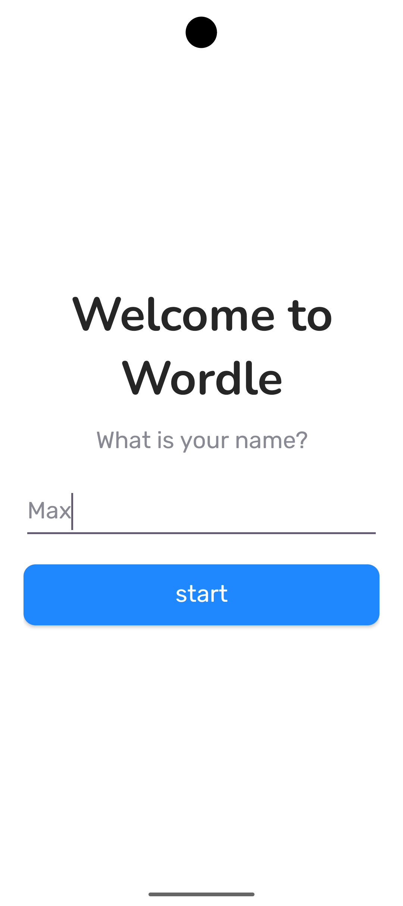
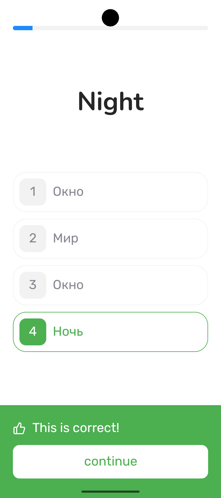
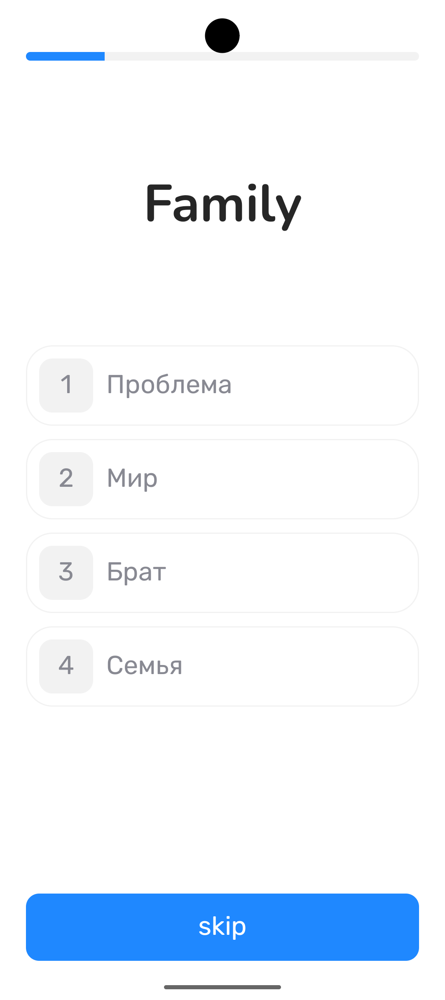
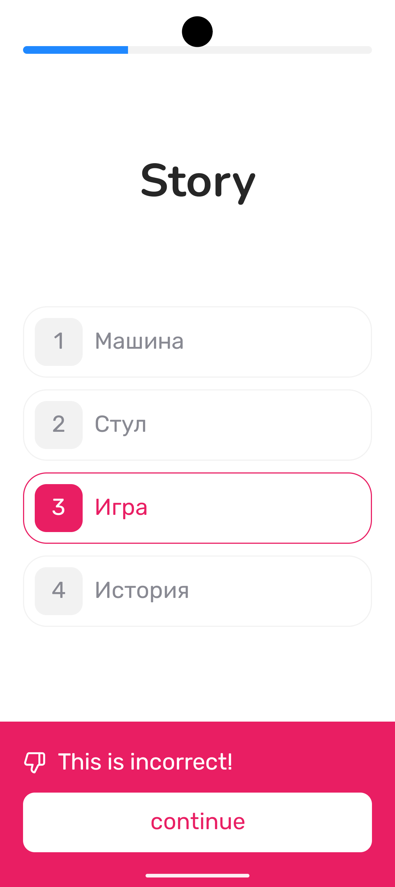
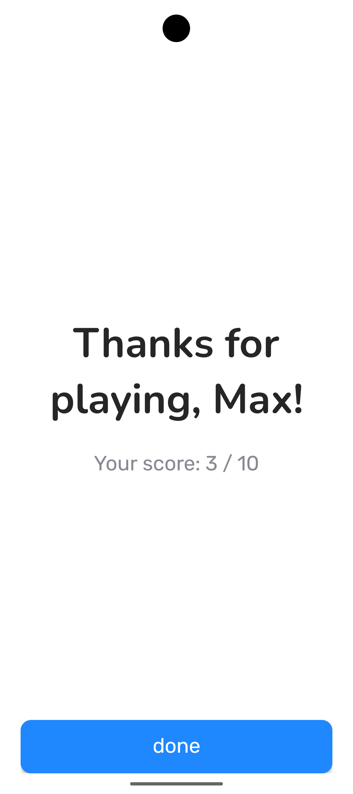

# Wordle

Wordle is a small Android app for practising English vocabulary. The player enters their name,
answers 10 translation questions, and sees their score on the final screen.

## Android versions

| Setting     | API level |
|-------------|----------:|
| Minimum SDK |        26 |
| Target SDK  |        37 |
| Compile SDK |        37 |

## Screenshots

## Downloads and logs

- APK: [Releases](../../releases)
- Logs: [logs/log.txt](logs/log.txt)